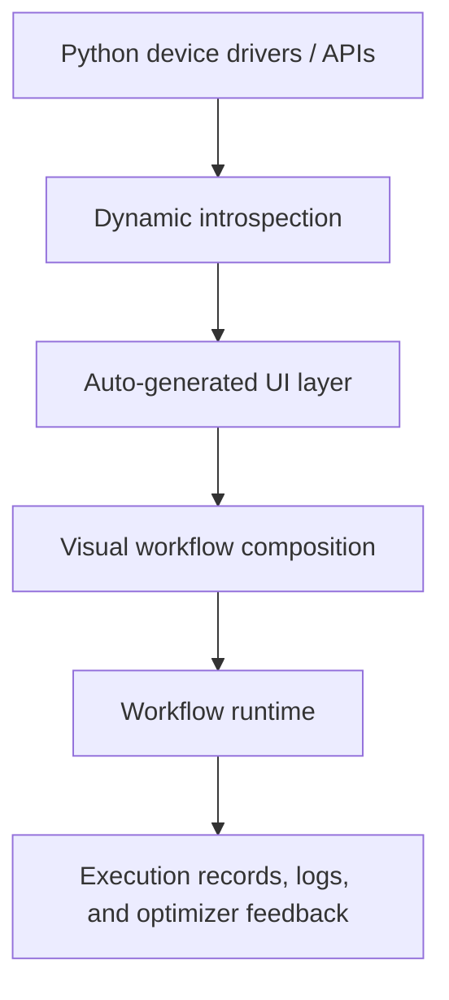

# Architecture notes

IvoryOS is organized around a small core package plus route, runtime, parser, service, and UI layers. Keep new code in the narrowest package that owns the behavior.

## System model

IvoryOS separates platform integration from workflow execution:

The codebase should preserve that boundary. Integrators expose normal Python APIs; IvoryOS generates controls and workflow actions; the runtime executes the selected workflow and records what happened.

## Main package areas

- `ivoryos/core/`: system-level abstractions such as module loading and return handling.
- `ivoryos/forms/`: dynamic form and WTForms logic.
- `ivoryos/models/`: database models.
- `ivoryos/parsers/`: data serialization, JSON parsing, and type conversion.
- `ivoryos/runtime/`: workflow execution, flow control, and queue behavior.
- `ivoryos/services/`: backend services such as LLM-assisted design, drafts, and client proxy logic.
- `ivoryos/routes/`: Flask routes and route-local request handling.
- `ivoryos/static/` and `ivoryos/templates/`: browser UI assets and templates.

## Change guidance

- Put user-visible behavior changes in `CHANGELOG.md`.
- Put larger module-boundary or migration notes in [Refactor summary](refactor-summary.md).
- Keep operator-facing runtime behavior in [Run behavior](../users/run-behavior.md); keep code-level runtime design decisions in ADRs.
- Keep code package directories for code and docstrings; longer prose belongs under `/docs/source`.
