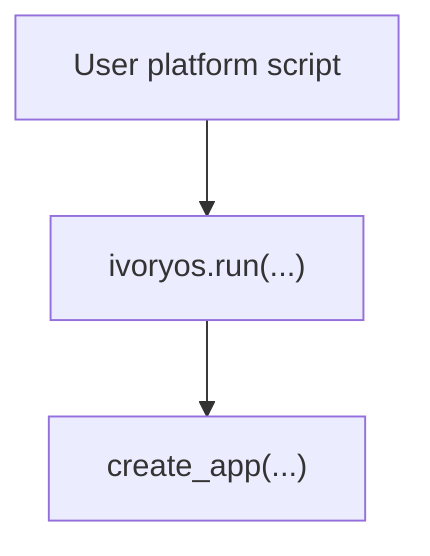

# Docs organization

Use `/docs/source` as the home for long-form documentation.

## Audience folders

- `users/`: browser UI workflows, direct control, workflow execution, run phases, data review, screenshots, output files, and operator guidance.
- `examples/`: cross-audience platform examples, community integrations, gallery links, and showcase material.
- `integrators/`: launch settings, instrument exposure, input type annotations, Enum dropdowns, plugins, Python clients, MCP, remote instruments, and external systems.
- `developers/`: contributor setup, development workflow, testing, codebase structure, runtime internals, extension points, data model, HTTP route reference, ADRs, release notes, refactor notes, and docs maintenance.

## Format

Write narrative docs in Markdown. Use reStructuredText for pages that depend on Sphinx autodoc, Flask route extraction, or other directive-heavy behavior.

The root index, runtime API reference, and route reference pages stay in reStructuredText because `autodoc` and `sphinxcontrib.autohttp.flask` render reliably there.

## Diagrams

Draw a flow chart as a `mermaid` block, not as ASCII art in a `text` block. Sphinx renders it
in the docs' colours (`sphinxcontrib-mermaid`, configured in `docs/source/conf.py` and styled in
`_static/custom.css`), and GitLab renders the same block when the file is opened in the
repository:

````text

````

Put every label in quotes. Inside a label, write `<` and `>` as `#lt;` and `#gt;`, and the
underscores of a name like `__name__` as `#95;`; otherwise Mermaid reads them as HTML and as
bold text. Mermaid keywords such as `call` and `end` cannot be used as node names. After adding
a diagram, build the docs and look at the page: the diagram is drawn in the browser, so one
that fails to parse shows a "Syntax error in text" picture there and the build does not warn
about it. Directory trees, paths and commands stay in `text` blocks.

## Canonical locations

- Keep `CHANGELOG.md` at the repository root because packaging, release tooling, and contributors expect it there. The docs site includes it from [Release notes](release-notes.md).
- Keep architecture and migration notes under `developers/`. If a root-level summary is needed for visibility, make it short and link back to the docs page.
- Keep package directories focused on Python code and docstrings. Do not add standalone `.md` docs under `ivoryos/`.
- Keep generated docs output out of source control. Build output belongs in ignored directories such as `docs/build/` or `docs/source/_build/`.
- Add an ADR under `developers/adr/` when a change affects runtime shape, integration contracts, deployment model, or optimizer/plugin extension contracts.

## Screenshots

The annotated screenshots in the user docs live in `_static/screenshots/` and are generated,
not taken by hand. `docs/screenshots/capture_screenshots.py` starts the abstract SDL example in
a temporary folder, drives the UI with Playwright the way a user would (it builds and runs the
`solubility_screen` workflow), labels the parts each page describes, and overwrites the PNGs:

```console
pip install -e ".[doc]" playwright
playwright install chromium
python docs/screenshots/capture_screenshots.py
python docs/screenshots/capture_screenshots.py --only execute-config,execute-running
```

Re-run it after a UI change so the pictures match what users see. Each labelled part gets a soft
orange outline and a numbered card, linked to it by a curved arrow (or, where there is little room,
a straight line ending in a dot), and the rest of the page is dimmed. The card names the part, with a short hint only where one helps; the numbered list
under the image explains it in full. The labels are listed in the script next to the docs page
that explains them; when one is added, moved or removed, update the numbered list under that image
too. In a shot of a dialog the cards are kept outside the dialog and the page is not dimmed twice,
so the whole dialog is readable. The script reports a card that covers a labelled part, another
card or the dialog. A cropped screenshot is widened where its crop would cut off a card; the
script says so when it does, and the image's `:width:` in the docs page (half its pixel width)
then needs updating. The cards use the Manrope font from Google Fonts and fall back to the system
font without a connection. The Bayesian Optimization screenshot
needs an optimizer installed (`pip install -e ".[optimizer-ax]"`) and is skipped otherwise.
On a machine that cannot reach the CDNs the UI loads its libraries from, pass `--cdn-mirror`
with an npm `node_modules` folder holding them (the script lists the packages).

Every PNG changes on each run because fonts and anti-aliasing differ between machines, so
expect the whole folder to show up in `git diff` and commit all of it rather than a subset.
There is no CI check for stale screenshots; regenerating them is part of a UI change.

## External docs

Suite project pages are generated from their upstream README files during the Sphinx build:

- `integrators/client-api.md` from `ivoryos-client` `README.md`.
- `integrators/mcp-server.md` from `ivoryos-mcp` `README.md`.
- `integrators/plugins.md` from `ivoryos-plugin-template` `README.md`.

Do not edit those generated files directly. Update `external_readmes` in `docs/source/conf.py` if a source URL or target path changes.
