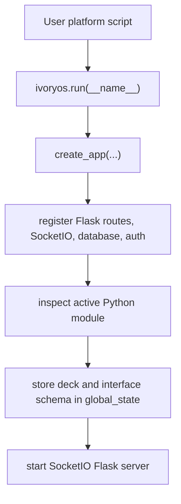
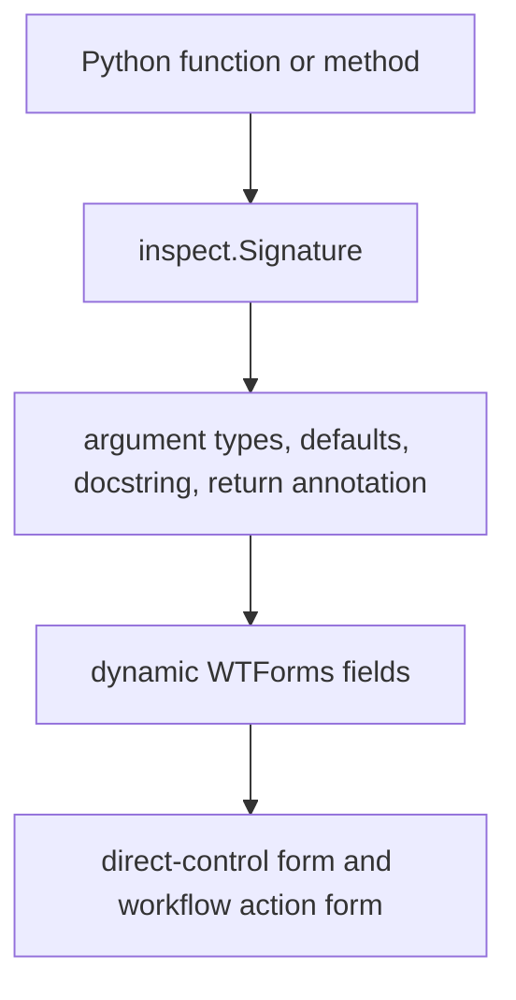
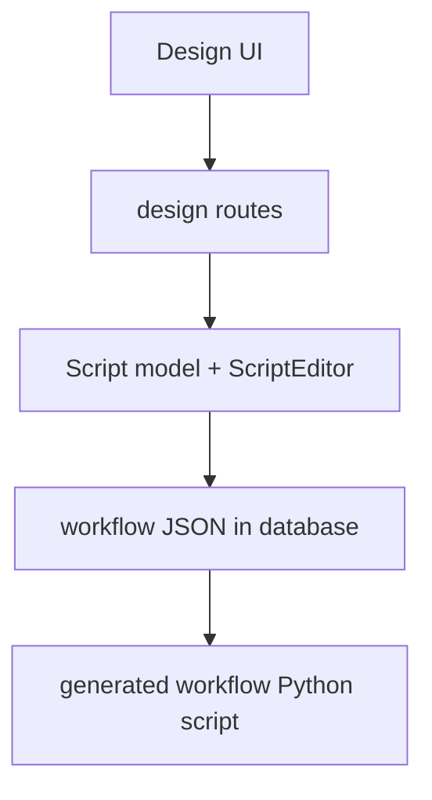
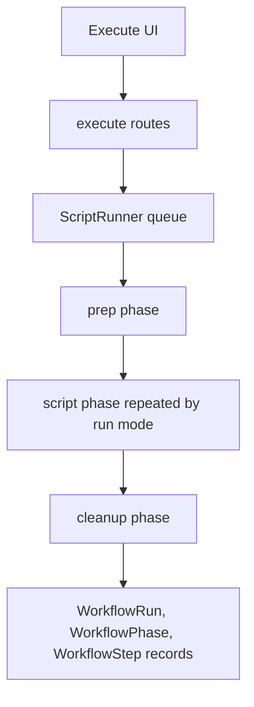
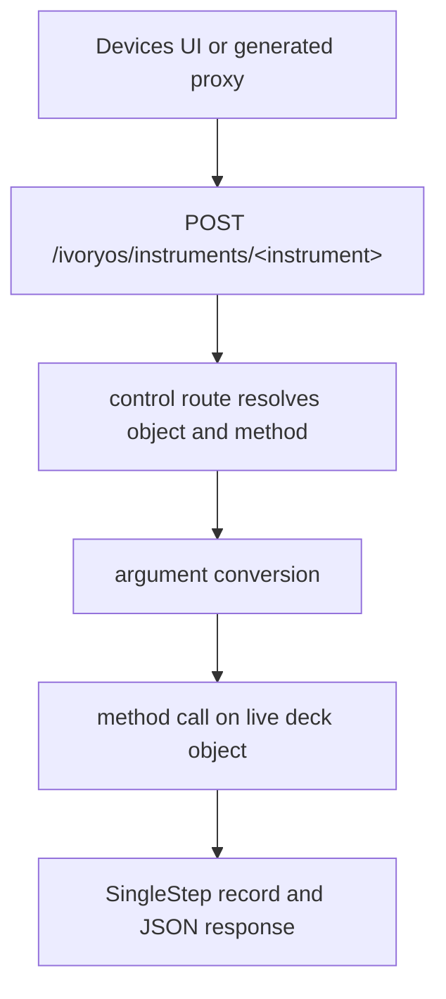

# Runtime walkthrough

This page follows the main path from a platform script to a completed workflow run.

## Startup path

`ivoryos.run(...)` lives in `ivoryos/server.py`. It creates the Flask app, imports workflow templates, loads plugins, registers loggers and notification handlers, configures optimizers, and starts the server.

When `module` is provided, IvoryOS starts from the active Python module:

- `global_state.deck` stores the active Python module.
- `generate_interface_schema(...)` inspects the deck and writes a pseudo-deck schema.
- `generate_block_schema(...)` registers built-in flow-control blocks.
- `create_module_interface_schema(...)` builds the API variable view.

## Interface generation

Key files:

- `ivoryos/parsers/introspection.py`
- `ivoryos/forms/dynamic_forms.py`
- `ivoryos/parsers/type_conversions.py`
- `ivoryos/parsers/returns.py`

Return annotations matter. Scalar returns show one save field. Fixed-length tuple returns show one save field per tuple item.

## Workflow design path

Key files:

- `ivoryos/routes/design/`
- `ivoryos/script/models.py`
- `ivoryos/script/editor.py`
- `ivoryos/script/renderer.py`

Workflows are stored as structured data with three phases: `prep`, `script`, and `cleanup`.

## Execution path

Key files:

- `ivoryos/routes/execute/`
- `ivoryos/runtime/script_runner.py`
- `ivoryos/runtime/script_runner_queue.py`
- `ivoryos/runtime/script_runner_workflow.py`
- `ivoryos/runtime/script_runner_steps.py`
- `ivoryos/parsers/returns.py`

Only one workflow task runs at a time through the shared runner lock. Queue behavior, pause/resume, stop pending, stop current, and cleanup behavior are user-facing runtime behavior; see [Run behavior](../users/run-behavior.md).

## Direct-control path

Key files:

- `ivoryos/routes/control/`
- `ivoryos/services/client_proxy.py`
- `ivoryos/models/execution.py`

Direct-control calls are logged as `SingleStep` records. Remote proxy clients use the same route contract.
