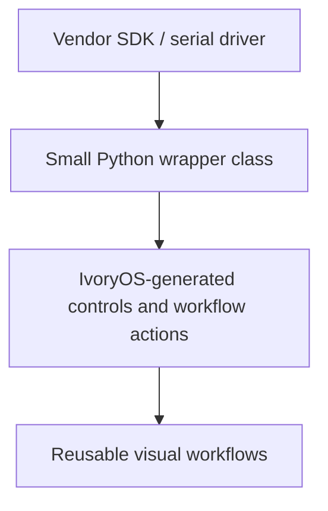

# Python-native integration

IvoryOS integrates with normal Python automation code. The preferred pattern is to keep vendor SDK details inside small wrapper classes and expose stable, typed methods to IvoryOS.

## What IvoryOS reads

When `ivoryos.run(__name__)` starts, IvoryOS inspects the active Python module and initialized objects. It uses:

- public function and method names;
- parameter names;
- type hints;
- default values;
- docstrings;
- return annotations.

Those Python API details become direct-control forms, workflow actions, configurable run parameters, generated proxy clients, and design-agent context.

## Basic pattern

```python
class Balance:
    def __init__(self, port: str):
        self.driver = VendorBalance(port=port)

    def tare(self) -> None:
        """Tare the balance."""
        self.driver.tare()

    def read_mass_mg(self) -> float:
        """Read the current mass in milligrams."""
        return self.driver.read_mass(unit="mg")


balance = Balance(port="COM4")

import ivoryos

ivoryos.run(__name__)
```

IvoryOS sees `balance.tare()` and `balance.read_mass_mg()` and exposes them in the UI. The method docstrings and type hints help users understand and configure the actions.

## Keep the public API small

Do not expose every low-level vendor method directly. A good integration wrapper gives users a small set of experiment-level actions:

- `tare()`
- `dose_solid(amount_in_mg: float)`
- `dose_solvent(solvent_name: Solvent, amount_in_ml: float)`
- `equilibrate(temp: float, duration: float)`
- `analyze(sample_id: str) -> float`

Private helper methods should be prefixed with `_` so they are treated as implementation details.

## Separate hardware from workflow

Keep hardware implementation inside driver or wrapper classes. Keep workflow composition in IvoryOS.



This separation lets automation engineers update hardware code without asking users to rebuild workflows from scratch.

## Integration checklist

- Add clear type hints to public methods.
- Add defaults for common values.
- Use `Enum` for fixed choices that should appear as dropdowns.
- Add docstrings to methods users will see in the UI.
- Prefix internal helpers with `_`.
- Keep long-running calls synchronous unless the workflow is designed around background execution.
- Regenerate remote proxy clients after changing method names, argument names, annotations, or return values.
