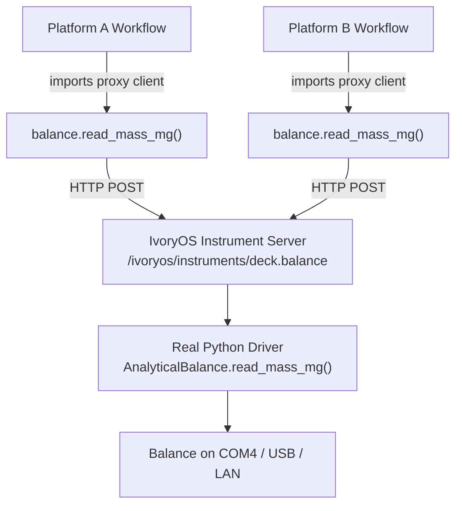

# Remote instrument proxy

IvoryOS can expose a real Python instrument as an HTTP-backed instrument server. Other IvoryOS platforms, scripts, or workflow runners can import a generated proxy client and call the remote instrument as if it were a local Python object.

Use this pattern when:

- one instrument must be shared by multiple platforms;
- one machine owns the hardware connection, driver, license, or API credentials;
- a workflow on another machine needs a small number of direct instrument calls;
- you want IvoryOS to be the access-control and logging boundary for an instrument.

## Model



The instrument server owns the real driver object. Proxy clients only send method names and arguments to the server.

## 1. Start an instrument server

On the machine connected to the real instrument, create a normal IvoryOS deck script. This example uses a shared analytical balance. Replace `vendor_balance_sdk` with the driver package for the actual balance.

```python
from vendor_balance_sdk import BalanceDriver


class AnalyticalBalance:
    def __init__(self, port: str):
        self.driver = BalanceDriver(port=port)

    def tare(self) -> None:
        """Tare the balance."""
        ...


balance = AnalyticalBalance(port="COM4")

import ivoryos

ivoryos.run(__name__, host="0.0.0.0", port=8000)
```

IvoryOS inspects `balance` and exposes it as:

```text
/ivoryos/instruments/deck.balance
```

## 2. Generate the proxy client

Open the instrument server in a browser and download the generated proxy Python interface:

```text
http://<host>:<port>/ivoryos/instruments/files/proxy
```

The generated file contains one Python class per exposed instrument and a default instance for convenience. For `deck.balance`, the default instance is `balance`.

Place the generated proxy file somewhere importable by the remote workflow, for example beside the Platform A or Platform B workflow script.

## 3. Use the proxy in another workflow

In a different platform workflow, import the generated proxy and call the remote instrument method.

```python
from generated_proxy import balance

balance.tare()
```

From the workflow author's perspective, `balance.read_mass_mg()` looks like a local Python call. At runtime it sends an authenticated HTTP POST to the IvoryOS instrument server.

## What the proxy sends

The proxy sends JSON to the direct-control route:

```text
POST /ivoryos/instruments/deck.balance
```

```json
{
  "hidden_name": "read_mass_mg"
}
```

The server converts argument types using the real method signature, executes the driver method, stores a single-step record, and returns JSON:

```json
{
  "success": true,
  "output": 10.12
}
```

## Authentication

The generated proxy uses an authenticated `requests.Session`. By default it tries the local default credentials:

```python
from generated_proxy import Balance

balance = Balance(username="admin", password="admin")
```

Use deployment-specific accounts for shared instruments. Avoid sharing administrator credentials between platforms.

## Concurrency

Direct-control calls use the shared runner lock. If a second caller reaches the same IvoryOS server while another task is active, the server returns a busy response unless the call explicitly overrides the busy lock.

For shared physical instruments, treat the IvoryOS instrument server as the serialization point. This prevents two platforms from driving the same hardware at the same time.

## When not to use this pattern

Do not use the proxy client as a replacement for every integration:

- Use a plugin when the remote system needs a custom UI page.
- Use the Python client or MCP server when the remote system needs workflow-level operations such as loading scripts, running campaigns, or reading records.
- Use a dedicated instrument SDK when several systems need rich local driver behavior and can safely manage their own connections.

## Operational notes

- Keep the server reachable from all client platforms.
- Keep the IvoryOS URL prefix as `/ivoryos` unless the generated proxy and deployment agree on another path.
- Regenerate the proxy after changing exposed instrument method signatures.
- Put stable type hints on remote instrument methods so the generated proxy and server-side conversion stay predictable.
- Keep long-running methods synchronous from the caller's perspective unless the workflow is designed around background execution.
