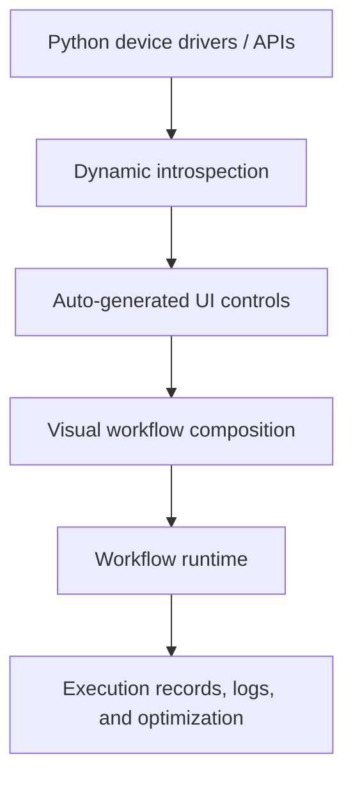

# Introduction

**IvoryOS** is an open-source orchestration platform and runtime for self-driving laboratories and scientific automation.

IvoryOS turns existing Python automation code into an interactive control panel, a drag-and-drop workflow designer, an execution runtime, and an optimization-ready experimentation interface.

The Python modules can be hardware APIs, high-level functions, or experiment workflows. With minimal changes to an existing workflow, users can design, manage, execute, and monitor experimental plans.

## Core concepts

IvoryOS is built around a simple flow:



For users, this means the UI is generated from the Python platform that is currently running. New device methods and workflow functions can appear as controls and workflow actions without a hand-written frontend page.

IvoryOS supports both fully automated and human-in-the-loop operation. A workflow can run unattended, pause for manual intervention, retry a failed step, or wait for approval before continuing.

## SDL workflow execution

Most autonomous workflows need customized iteration options. There is also a common need for pre-experiment and post-experiment steps. IvoryOS includes three built-in workflow phases:

1. Preparation: execute once before the main experiment.
2. Experiment: execute the main workflow multiple times based on the current configuration.
3. Clean up: execute once after the main experiment.

## Execution options

| Parameter Type | Output Type: Any | Output Type: Numerical |
| --- | --- | --- |
| Constant | Define **repeat** times | Define **repeat** times |
| Configurable | Configure **parameters** | Configure **optimizer** parameters |

1. **Repeat** is available only for workflows without configurable dynamic parameters.
2. **Parameters** is available for workflows with configurable dynamic parameters.
3. **Optimizer** is available only for workflows with configurable dynamic parameters and numerical outputs.

## IvoryOS output files

When you run the application for the first time, IvoryOS creates the following folders and files in the working directory:

- `ivoryos_data/`: main directory for application-related data.
- `ivoryos_data/config_csv/`: iteration configuration files in CSV format.
- `ivoryos_data/llm_output/`: raw prompts generated for the large language model.
- `ivoryos_data/pseudo_deck/`: generated interface schema `.pkl` files.
- `ivoryos_data/results/`: workflow execution results.
- `ivoryos_data/scripts/`: Python scripts compiled from visual workflows.
- `default.log`: application log file.
- `ivoryos.db`: local application database.

```text
ivoryos_data/
|-- config_csv/
|   |-- example_config.csv
|   `-- example_config_empty.csv
|-- llm_output/
|   `-- prompt.txt
|-- pseudo_deck/
|   `-- abstract_sdl.pkl
|-- results/
|   `-- example_2024-08-23 23-22.csv
|-- scripts/
|   |-- example.json
|   `-- example.py
|-- default.log
`-- ivoryos.db
```
